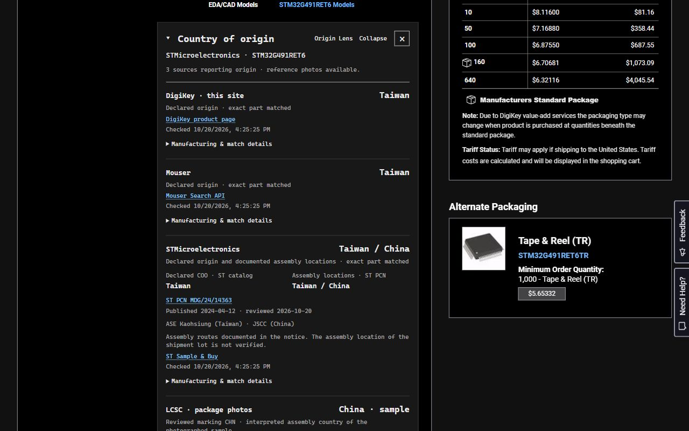
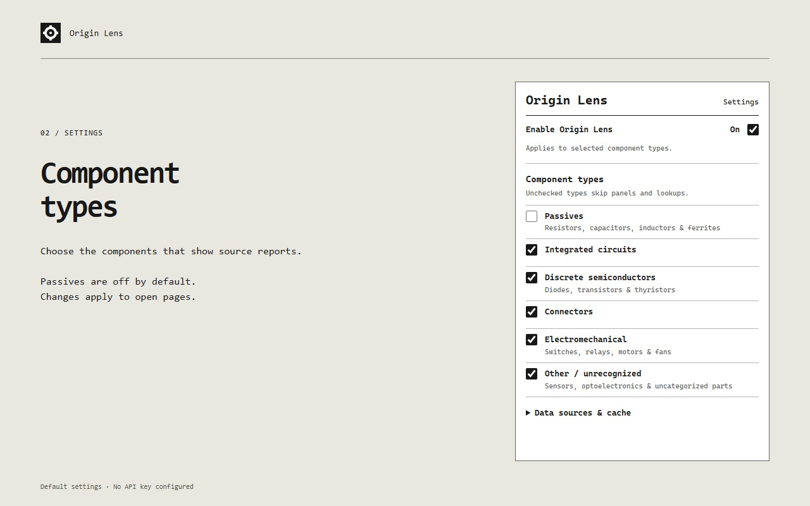
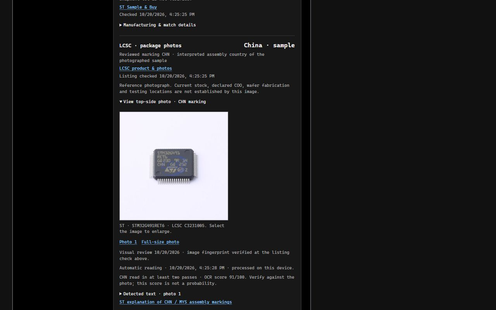

# Origin Lens

Compare country-of-origin and manufacturing reports while browsing DigiKey or
Mouser. See each source separately, with links to its evidence, package-photo
markings, and supported STM32 ordering options.

**[Download 0.12.5](https://github.com/hornej/hw-skills/releases/download/origin-lens-v0.12.5/origin-lens-0.12.5.zip)** ·
[Source setup](SETUP.md) · [Report an issue](https://github.com/hornej/hw-skills/issues)

Example source reports for STM32G491RET6. Coverage varies by part.

## Install or update

Requires desktop Chrome 120 or newer. This is a beta distributed through GitHub;
it is not yet listed in the Chrome Web Store. No build tools or developer account
are needed.

1. Download the ZIP above and extract it into a permanent folder, such as
   `Documents/Origin Lens`. Keep this folder after installation.
2. Open `chrome://extensions` and turn on **Developer mode**.
3. Click **Load unpacked** and select the extracted folder containing
   `manifest.json`.
4. Open a DigiKey or Mouser product page. Try
   [STM32G491RET6 on DigiKey](https://www.digikey.com/en/products/detail/stmicroelectronics/STM32G491RET6/13592591).
   The **Country of origin** panel appears in the product details.

Pin Origin Lens from Chrome's Extensions menu for easy access to its settings.
If your work browser blocks **Load unpacked**, ask your browser administrator.
These steps follow [Chrome's installation guide](https://developer.chrome.com/docs/extensions/get-started/tutorial/hello-world#load-unpacked).

Downloading the full repository instead? Select its `extensions/origin-lens`
folder in step 3. The release ZIP above contains just the extension.

## Setup for maximum coverage

**Version 0.12.5 uses one user-supplied API key: Mouser Search API.**
To enable every currently implemented source, complete these three steps in
the **same browser profile** where Origin Lens is installed:

1. **Mouser:** [get a Search API key](SETUP.md#mouser-search-api), then save it
   under **Origin Lens → Data sources & cache**. This enables lookup from either
   distributor page without opening or signing in to Mouser.
2. **DigiKey:** sign in and have at least one saved list; an empty list is enough.
   If a list is missing, the panel provides setup instructions. You do **not**
   need to add each part to the list. No DigiKey API key is used.
3. **Texas Instruments:** sign in through
   [myTI Import details](https://www.ti.com/support/import-details.html).
   The TI tab can then be closed. No TI API key is used; sign in again if the
   browser session expires.

**Automatic, no credentials:** ST (supported STM32 parts), Microchip, Infineon,
Harwin, Samtec, and LCSC STM32 package photos with local marking recognition.
These sources work independently of the Mouser key.

**Not used by this extension:** TI Product Information/Store API keys, LCSC or
JLCPCB API keys, Nexar credentials, or an AI/OCR service key. Credentials saved
in Bitwarden or used by other hw-skills tools are not imported automatically.

Keep **Enable Origin Lens** on, select the component types you want, then click
**Refresh** on a product page. Coverage still depends on the exact part and
available source data. See [setup and troubleshooting](SETUP.md).

## Use

- **Enable Origin Lens** turns panels and lookups on or off across open pages.
- **Component types** controls which parts show a panel. Passives are off by default.
- Click the panel heading to **collapse or expand** it. **×** hides it until
  you reload the page or turn the extension off and on.
- **Refresh** checks the sources again. Expand source details to inspect
  manufacturing stages, dates, and part matching.
- On supported STM32 parts, **Ordering options** compares package, packing,
  temperature, and declared origin across the base part's ordering codes.

| Component controls | Package-photo evidence |
| --- | --- |
|  |  |
| Choose which component types trigger lookups. | Inspect the photo, recognized markings, and sample limitations. |

Select any screenshot to enlarge it.

## Update an unpacked installation

Updates are manual until the Chrome Web Store edition is available.

1. Download the current release linked above and extract it.
2. Replace the contents of the installed extension folder with the new files,
   keeping the **same folder path**, including `vendor` and `icons`.
3. In `chrome://extensions`, click **Reload** on Origin Lens. Then reload open
   DigiKey and Mouser pages.

Keeping the same installation preserves settings and the saved Mouser key.
Do not remove and reinstall for routine updates. Chrome's **Update** button
does not download GitHub releases.

## Reading the results

A catalog's declared origin does not establish every manufacturing stage or
the origin of a particular shipment. Samtec's probable-origin estimates and
LCSC photo readings are labeled separately. Package photos describe a sample;
ordering options are not a guarantee of drop-in compatibility. Origin Lens
does not certify a China-free supply chain.

Requests go directly to the suppliers. Settings and saved reports stay in your
browser; photo recognition runs locally. No publisher server or analytics is
used. See the [privacy policy](PRIVACY.md).

## More

[Source coverage](SOURCES.md) · [Evidence and behavior](DETAILS.md) ·
[Development and publishing](DEVELOPMENT.md) · [Change history](CHANGELOG.md)
